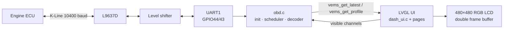

# K-Line ECU Reader · ESP32-S3 OBD-II K-Line Live Data Dashboard & DTC Scanner

**Open-source OBD-II K-Line diagnostic tool for older cars.** An ESP32-S3 with a 2.1" round touch screen talks directly to the engine ECU over the **K-Line** (ISO 9141-2 / ISO 14230-4 KWP2000) through an **L9637D** transceiver. It shows **live engine data**, the **vehicle profile** (every PID the ECU supports) and **reads and clears trouble codes (DTC)**. No ELM327, no phone, no app.

[](https://docs.espressif.com/projects/esp-idf/en/v5.3/esp32s3/)
[](#hardware)
[](#supported-protocols-and-vehicles)
[](https://lvgl.io)
[](LICENSE)

> 🇹🇷 **Türkçe:** ESP32-S3 ile eski araçlarda (CAN öncesi, K-Line hatlı) OBD-II canlı veri okuma, araç profili ve arıza kodu okuma/silme. Türkçe açıklama için [aşağıya bakın](#türkçe).
>
> 📘 **Build guide / Montaj rehberi:** [K-Line OBD Montaj Rehberi](https://erdemerciyas.github.io/K-line-Ecu/k-line-obd-montaj-rehberi.html): perfboard and breadboard layout, wire list, continuity tests, K-Line measurement map (Turkish).

**Keywords:** ESP32 K-Line, ESP32 OBD2, OBD-II K-Line reader, KWP2000 ESP32, ISO 9141-2 ESP32, ISO 14230-4, L9637D ESP32, ELM327 alternative, DIY OBD2 scanner, car ECU live data, DTC reader, check engine light, Chevrolet Kalos OBD, Daewoo Kalos K-Line, ESP-IDF OBD, LVGL car dashboard, Waveshare ESP32-S3-Touch-LCD-2.1.

---

## Contents

- [Why this project](#why-this-project)
- [Features](#features)
- [Supported protocols and vehicles](#supported-protocols-and-vehicles)
- [Hardware](#hardware)
- [Wiring](#wiring)
- [Screens](#screens)
- [How it works](#how-it-works)
- [Performance: how fast is K-Line?](#performance-how-fast-is-k-line)
- [Build and flash](#build-and-flash)
- [Configuration](#configuration)
- [Troubleshooting](#troubleshooting)
- [Safety](#safety)
- [FAQ](#faq)
- [Project structure](#project-structure)
- [Türkçe](#türkçe)
- [License](#license)

---

## Why this project

Most European petrol cars built roughly between 2001 and 2008 have an OBD-II socket but **no CAN bus**. Diagnostics run over a single wire, the **K-Line** (OBD pin 7). Cheap ELM327 clones handle it badly. They are slow and add Bluetooth latency, and many get stuck at the 5-baud init.

This project skips the adapter entirely. The ESP32-S3 speaks the K-Line protocol itself, with bit-exact init timing, and draws every value on its own screen the moment the ECU answers.

## Features

- **Native K-Line stack**: ISO 14230-4 (KWP2000) **fast init**, 5-baud **slow init** for ISO 9141-2 and KWP2000, and automatic protocol detection with echo and line diagnostics.
- **Full vehicle profile**: reads the supported-PID bitmaps (`01 00 / 20 / 40`) and polls **every supported SAE J1979 mode 01 PID** (01–5F) with Turkish names, units and decoders.
- **Screen-aware scheduler**: the PIDs of the page you are looking at are polled first, and everything else is polled in the background.
- **Self-tuning**: PIDs the ECU claims but never answers are dropped after 3 misses, so no time is wasted on timeouts. Static values (OBD standard, O2 sensor map, fuel type) are read once.
- **Trouble codes (DTC)**: reads stored codes (mode 03) with descriptions, and clears codes and the MIL (mode 04) with two-tap confirmation, blocked while the engine runs.
- **MIL status**: shows the check-engine light and the stored code count on the drive page (PID 01).
- **Fuel consumption**: L/h and L/100 km from PID 5E, from MAF, or estimated by speed-density from MAP, IAT and RPM on cars without a MAF.
- **Round 480×480 LVGL UI**: RPM ring with shift light, single-gauge page with min/max, an all-data list, AFR page (wideband), connection statistics and settings stored in NVS.
- **Tear-free display**: double PSRAM frame buffers, swapped at VSYNC. The UI redraws as soon as a new ECU frame arrives (20 ms check).
- **Diagnostics built in**: the boot screen shows every init step and the exact failure point ("K-Line not pulled low", "no echo" ...), and the USB log prints raw K-Line bytes.

## Supported protocols and vehicles

| Protocol | Standard | Init | Status |
|---|---|---|---|
| KWP2000 | ISO 14230-4 | fast init (25 ms wake-up) | ✅ supported |
| KWP2000 | ISO 14230-4 | 5-baud init | ✅ supported |
| ISO 9141-2 | ISO 9141-2 | 5-baud init | ✅ supported |
| CAN | ISO 15765-4 | — | ❌ not in this firmware (K-Line only) |

**Tested on:** Chevrolet / Daewoo **Kalos 1.4 16V** (F14D3, KWP2000 fast init).

**Should work on** any car whose OBD-II socket has pin 7 (K-Line) and no CAN on pins 6/14. That covers many pre-2008 European and Asian petrol cars. The firmware reads what the ECU reports as supported, so there is no per-car configuration.

## Hardware

| Part | Notes |
|---|---|
| **Waveshare ESP32-S3-Touch-LCD-2.1** | ESP32-S3, 16 MB flash, 8 MB octal PSRAM, 480×480 round IPS (ST7701S), CST820 touch |
| **L9637D** K-Line transceiver (SOIC-8 on a DIP adapter) | ISO 9141 physical layer, 12 V bus side |
| 4-channel logic level shifter (BSS138 type) | 3.3 V ESP ↔ 5 V L9637D |
| L78L05 regulator | 5 V for the L9637D from the car's 12 V |
| 1N4005 diode, 510 Ω (2 × 1 kΩ parallel) K pull-up, 2 × 100 nF | protection, bus pull-up, decoupling |
| OBD-II male plug with cable | pins 4/5 GND, 7 K-Line, 16 +12 V |
| 4-wire cable to the board's UART header | GND, 3V3, TXD, RXD |
| Car USB charger + USB-C cable | powers the screen board |

A full step-by-step build guide (perfboard layout, breadboard layout, wire list, continuity tests and a measurement map for "K-Line does not go low") is in [`docs/k-line-obd-montaj-rehberi.html`](https://erdemerciyas.github.io/K-line-Ecu/k-line-obd-montaj-rehberi.html) (Turkish).

## Wiring

```
 OBD-II socket                L9637D                      level shifter            Waveshare UART header
 ─────────────                ──────                      ─────────────            ─────────────────────
 pin 16 (+12 V) ─┬─ 1N4005 ─► pin 7 VS                    HV  ◄── 5 V (78L05)      3V3 ──► LV
                 └─ 78L05 ──► pin 3 VCC (5 V)             LV  ◄── 3V3
 pin 7  (K)  ◄──────────────► pin 6 K  (510 Ω to VS)      HV1 ──► pin 4 TX          RXD = GPIO44 ──► LV1   (K TX)
 pin 4/5 (GND) ─────────────► pin 5 GND                   HV2 ◄── pin 1 RX          TXD = GPIO43 ◄── LV2   (K RX)
                                                          GND ─── common GND        GND ─── GND
```

> ⚠️ **The header labels cross over.** The header's **RXD (GPIO44) is our TX** and **TXD (GPIO43) is our RX**.
> ⚠️ **Leave the "UART" USB-C port unplugged.** When it is connected, an on-board FSUSB42 switch routes GPIO43/44 to the CH343 USB-UART and the header is cut off. Power, flash and watch logs through the **"USB"** USB-C port.

## Screens

Swipe left / right between pages:

| Page | What it shows |
|---|---|
| **Boot** | init steps live: display, K-Line interface, fast/slow init, ECU address, PID scan, with the result of each step |
| **Drive** | RPM ring + shift light, speed, 6 tiles (MAP, O2/AFR, coolant, intake, throttle, L/100 km …), info line (fuel flow, rear O2, timing …), MIL + code count, open/closed loop |
| **Single gauge** | one value large with a 270° ring and session min/max. Tap left/right to switch values, long-press to reset |
| **All data** | every channel in one scrolling list |
| **Vehicle profile** | every PID the ECU supports: name, live value and **refresh interval** ("every 0.3 s") |
| **AFR** | lambda / AFR zones (only with a wideband sensor) |
| **Fault codes** | stored DTCs with descriptions, READ and CLEAR (two-tap confirm) |
| **Connection** | protocol, ECU, baud, supported value count, requests/s, timeouts, reconnects, rescan button |
| **Settings** | brightness, shift RPM, RPM max, fuel type (AFR), MAP/boost, coolant warning, low battery, boot sound |

## How it works



1. **Detect**: ISO 14230 fast init (25 ms low / 25 ms high, StartCommunication `81`, waits for `C1`). If that fails, 5-baud address `0x33`, key bytes and the inverted address. ISO 9141-2 vs KWP2000 is decided from key byte 2.
2. **Profile**: `01 00`, `01 20`, `01 40` give the supported-PID bitmaps. Static PIDs are read once.
3. **Poll**: RPM every other request. The PIDs feeding the visible page form the fast round, and one background PID is polled per round.
4. **Decode**: SAE J1979 formulas ([`main/obd_pid.c`](main/obd_pid.c)) fill both the dashboard data and the raw profile store.
5. **Draw**: the UI checks for a new frame every 20 ms and redraws straight into the hidden frame buffer, which is swapped at VSYNC.

## Performance: how fast is K-Line?

K-Line runs at 10400 baud, half duplex, and the standard enforces gaps (ISO 14230-4):

| Step | Time |
|---|---|
| request (6 bytes, 5 ms inter-byte P4, echo read back) | ~35 ms |
| ECU reaction (P2) | 25–50 ms |
| answer (~7 bytes) | ~7 ms |
| bus idle before next request (P3 ≥ 55 ms) | 60 ms |
| **total per PID** | **~130–150 ms → about 7 requests/s** |

That is a hard physical limit, so the firmware spends those 7 requests where you are looking. On the single-gauge page a value refreshes about every 0.3 s. On the drive page each tile refreshes every 1–2 s, and background values every few seconds. The **vehicle profile** page shows the real interval of every PID.

## Build and flash

Requirements: [ESP-IDF v5.3](https://docs.espressif.com/projects/esp-idf/en/v5.3/esp32s3/get-started/). LVGL 8.2 is included under `components/lvgl`.

```bash
git clone https://github.com/erdemerciyas/K-line-Ecu.git
cd K-line-Ecu
idf.py set-target esp32s3      # only the first time
idf.py build
idf.py -p COMx flash monitor   # "USB" USB-C port (USB-Serial-JTAG)
```

The console runs on USB-Serial-JTAG, and UART0 is unused because GPIO43/44 carry the K-Line. On boot you should see:

```
I (509) main: K-Line OBD, source: OBD-II K-Line
I (1281) lcd: ST7701S 480x480 RGB panel ready
I (2341) obd: K-Line on UART1 TX GPIO44 RX GPIO43
I (2767) obd: K TX     5 bayt: C1 33 F1 81 66
```

## Configuration

`idf.py menuconfig` → **K-Line OBD**:

| Option | Default | Meaning |
|---|---|---|
| `VEMS_OBD_KLINE_UART_PORT` | 1 | UART used for the K-Line |
| `VEMS_OBD_KLINE_TX_GPIO` / `_RX_GPIO` | 44 / 43 | K TX → L9637D pin 4, K RX ← pin 1 |
| `VEMS_ENGINE_CC` | 1399 | engine displacement for speed-density fuel consumption |
| `VEMS_PRINT_INTERVAL_MS` | 250 | live values on the console (0 = off) |
| `VEMS_PRINT_JSON` | n | also print one JSON line per sample |
| `VEMS_UI_RPM_MAX` / `_SHIFT` | 8000 / 6500 | RPM scale and shift light |
| `VEMS_UI_FUEL_*` | gasoline | stoichiometric AFR (gasoline, E85, LPG, methanol) |
| `VEMS_UI_BOOT_BEEP` | y | start-light beep on the on-board buzzer |

Most display settings can also be changed on the device (Settings page) and are kept in NVS.

## Troubleshooting

| Symptom (boot screen / log) | Likely cause |
|---|---|
| `K echo 0 bayt (yok)` + `TX LOW: TX pad 0, RX 1` | circuit not connected, RXD/TXD swapped, level shifter LV/HV reversed, or L9637D without 5 V on pin 3 |
| `TX pad 1` while driving low | "UART" USB-C plugged in (FSUSB42 switch), or the TX wire on the 3V3 pin |
| `K hep LOW` | K-Line shorted to GND, or the 510 Ω pull-up missing |
| `C1 yok` after fast init, slow init OK | normal for ISO 9141-2 cars |
| Value shows `--` | the ECU does not support that PID (check the **Vehicle profile** page) |

A complete measurement walkthrough with points 1–7 is in the [build guide](https://erdemerciyas.github.io/K-line-Ecu/k-line-obd-montaj-rehberi.html).

## Safety

- The firmware only sends **service 01** (current data), **03** (read DTCs) and **04** (clear DTCs, only after a two-tap confirmation and only with the engine stopped), plus the K-Line wake-up handshake. Any other service ID is rejected in `obd_tx_allowed()` before it reaches the bus.
- Do not connect an ELM327 or another tester at the same time. The K-Line must have a single tester.
- Clearing codes also resets the emission readiness monitors. Don't do it right before an inspection.

## FAQ

**Can an ESP32 read OBD-II without an ELM327?**
Yes. With an L9637D (or a discrete transistor stage) the ESP32's UART drives the K-Line directly. This project implements the full ISO 9141-2 / ISO 14230-4 init and request cycle in [`main/obd.c`](main/obd.c).

**Does it work with CAN (ISO 15765) cars?**
No, this firmware is K-Line only. Cars from about 2008 onward with CAN need a CAN transceiver and a different stack.

**Why not Bluetooth / a phone app?**
Every hop adds latency. Drawing on the same chip that talks to the ECU gives the lowest possible delay, about 20 ms plus one frame after the ECU answers.

**Which values will my car show?**
Exactly the ones its ECU reports as supported. The **Vehicle profile** page lists them all with live values.

## Project structure

```
main/
  obd.c            K-Line physical layer, fast/slow init, scheduler, DTC service, profile store
  obd_pid.c/.h     SAE J1979 mode 01 PID table: length, name, unit, decoder
  vems_proto.h     data model + public API (vems_get_latest, vems_get_profile, vems_dtc_read …)
  board_lcd.c      Waveshare 2.1": TCA9554, ST7701S init, RGB panel, CST820 touch, buzzer
  dash_ui.c        LVGL port, page manager, snapshot transitions, screen-aware polling
  ui_*.c           pages: splash, main, focus, list, profile, afr, dtc, link, settings
  settings.c       NVS-backed user settings
docs/
  k-line-obd-montaj-rehberi.html   hardware build guide (Turkish)
components/lvgl    LVGL 8.2 (MIT)
```

---

## Türkçe

### K-Line ECU Okuyucu: ESP32-S3 ile OBD-II K-Line canlı veri, araç profili ve arıza kodu

Bu proje, **CAN hattı olmayan eski araçlarda** (çoğunlukla 2001–2008 arası benzinli Avrupa ve Asya modelleri) OBD-II soketindeki **K-Line** (pin 7) üzerinden motor beynine doğrudan bağlanır. ELM327, Bluetooth ya da telefon uygulaması gerekmez. Bütün veriler kartın kendi 2.1" yuvarlak dokunmatik ekranında görünür.

**Öne çıkanlar:**

- **Kendi K-Line yığını:** ISO 14230-4 KWP2000 hızlı init, ISO 9141-2 ve KWP2000 için 5 baud yavaş init, otomatik protokol algılama.
- **Tam araç profili:** ECU'nun desteklediği **bütün** SAE J1979 servis 01 PID'leri (01–5F) Türkçe adları ve birimleriyle okunur. "Araç profili" sayfası her PID'in canlı değerini ve **kaç saniyede bir yenilendiğini** gösterir.
- **Ekrana göre sorgu:** o an açık olan sayfadaki değerler öne alınır, kalanlar arka planda sırayla okunur. Cevap vermeyen PID'ler 3 denemede listeden düşer, değişmeyen bilgiler bir kez okunur.
- **Arıza kodları:** kayıtlı kodları açıklamalarıyla okur. Siler (arıza lambasıyla birlikte), ama iki dokunuşla onay ister ve motor çalışırken izin vermez. Sürüş sayfasında `MIL · 2 KOD` uyarısı çıkar.
- **Yakıt tüketimi:** L/saat ve L/100 km. ECU bildiriyorsa PID 5E'den, MAF'tan, ya da MAF'sız araçlarda MAP/emme havası/devirden hesaplanır.
- **Gecikmesiz ekran:** çift PSRAM çerçeve tamponu, VSYNC'te yırtılmasız geçiş. Yeni veri geldiği anda ekran yeniden çizilir.
- **Yerleşik arıza teşhisi:** açılış ekranı her adımı ve sorunun tam yerini gösterir ("K inmiyor", "yankı yok" ...).

**Denendiği araç:** Chevrolet / Daewoo **Kalos 1.4 16V** (F14D3, KWP2000 hızlı init).

**Donanım:**
- Waveshare ESP32-S3-Touch-LCD-2.1 ekranlı kart,
- L9637D K-Line sürücüsü, 78L05 regülatör, 4 kanallı seviye dönüştürücü,
- 1N4005 diyot, 510 Ω çekme direnci, 100 nF kondansatörler,
- kablolu OBD-II erkek fiş.

Delikli plaket ve breadboard yerleşimi, kablo listesi, süreklilik testleri ve "K inmiyor" ölçüm haritası için [Türkçe montaj rehberine](https://erdemerciyas.github.io/K-line-Ecu/k-line-obd-montaj-rehberi.html) bakın.

**Bağlantı özeti:**
- Kartın UART başlığında **RXD = GPIO44 = K TX** (seviye dönüştürücü LV1) ve **TXD = GPIO43 = K RX** (LV2). Yazılar çapraz!
- Kart **"USB"** yazan Type-C'den beslenir; yükleme ve log da bu porttan yapılır.
- **"UART"** yazan Type-C boş kalmalı. Takılınca kart üzerindeki anahtar GPIO43/44'ü başlıktan ayırır ve K-Line çalışmaz.

**Derleme ve yükleme** (ESP-IDF v5.3):

```bash
idf.py set-target esp32s3
idf.py build
idf.py -p COMx flash monitor
```

**Hız neden sınırlı?** K-Line 10400 baud'dur ve standart her istek arasında en az 55 ms boşluk ister. Bu yüzden saniyede yaklaşık 7 PID okunabilir. Yazılım bu kapasiteyi ekranda baktığın değerlere ayırır: tek gösterge sayfasında bir değer yaklaşık 0.3 saniyede bir yenilenir.

**Güvenlik:** sadece servis 01 (canlı veri), 03 (arıza kodu okuma) ve onaylı 04 (silme) gönderilir. Başka hiçbir servis hatta çıkamaz. Cihaz bağlıyken sokete ELM327 takmayın.

---

## License

[MIT](LICENSE) © 2026 Erdem Erciyas. LVGL in `components/lvgl` is © LVGL Kft., [MIT](components/lvgl/LICENCE.txt).

If this project helped you read your car's ECU, please ⭐ the repository so others can find it.
